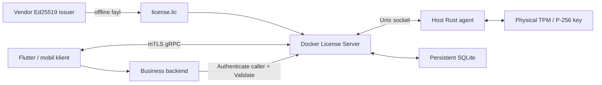

# Ecochain Offline License Manager

Rust + gRPC + mTLS + SQLite asosidagi bitta-server litsenziyalash moduli. Cloud va internetga chiqmaydigan LAN uchun bir xil offline verifier ishlatiladi.

**Holat:** Rust gRPC moduli, development Docker demo, fizik Linux TPM agent adapteri, pinned AK asosidagi NV attestation verifier va bir martalik offline migration implementatsiya qilingan. Development kaliti faylda saqlanadi va nusxalanadi; bu rejim fizik TPM himoyasini bermaydi. Manufacturer EK trust bootstrap va haqiqiy apparat acceptance’i alohida qoladi. Root compromise, relay va prepared policy session’lar ustidan universal revocation kafolati berilmaydi.

## Tez boshlash — Docker

Talablar: Docker Engine/Desktop va Compose v2. Birinchi build internet talab qiladi. Ishga tushgan demo internetga murojaat qilmaydi.

```bash
git clone https://github.com/ibrokhimal/ecochain-license-manager.git
cd ecochain-license-manager
bash scripts/docker-demo.sh
```

Skript image yaratadi, yangi demo kalitlarini yaratadi, serverni ishga tushiradi va quyidagilarni haqiqiy mTLS gRPC orqali tekshiradi:

- Alice litsenziyalangan inventory moduli uchun lease oladi.
- Xuddi shu request qayta yuborilsa o‘sha lease qaytadi.
- Bob ikkinchi foydalanuvchi sifatida kirsa `LIMIT_REACHED` oladi: demo limiti 1.
- Bob Alice lease’idan foydalana olmaydi.
- Ruxsat berilmagan billing moduli bloklanadi.
- Lease yangilanadi va renewal retry tekshiriladi.
- Server A litsenziyasi Server B apparat/kalit identifikatsiyasida rad etiladi.
- Server restartdan keyin SQLite holatini saqlaydi.

Demo 24 soatga yaratiladi. Skript mavjud `demo/`ni o‘chirmaydi yoki uning kalitlarini almashtirmaydi. Yangi demo kerak bo‘lsa serverni to‘xtating va eski papkani boshqa nomga saqlang. Ketma-ket smoke ishga tushirishlar har biri sessiya ochadi: bir foydalanuvchiga 4 sessiya, ular 180 soniyada tugaydi.

Skript serverni ishlayotgan holatda qoldiradi. Host porti `127.0.0.1:50051`; gRPC mTLS sabab oddiy brauzer bilan ochilmaydi.

Demo oddiy Docker bridge tarmog‘idan foydalanadi va portni faqat loopback’da ochadi. Dastur kundalik ishlashda internetga so‘rov yubormaydi; haqiqiy air-gap’da tashqi chiqishni host/tarmoq firewall’i cheklaydi. Docker `internal` tarmog‘i ayrim Engine konfiguratsiyalarida host port publishing’ni ham to‘xtatgani uchun bu yerda ishlatilmagan.

```bash
export LICENSE_UID="$(id -u)" LICENSE_GID="$(id -g)"
docker compose run --rm --no-deps client
docker compose logs --tail 30 license-server
docker compose down
```

Port band bo‘lsa `LICENSE_PORT=55051 bash scripts/docker-demo.sh` ishlating. Konteynerlar orasidagi port 50051 bo‘lib qoladi.

## Rust bilan lokal ishga tushirish

Rust 1.88+ va C compiler kerak. `protoc` build dependency orqali yetkaziladi.

```bash
cargo test --all-targets --locked
cargo build --bins --locked
target/debug/licensectl demo --out demo
target/debug/license-server \
  --config demo/server-a/server.json \
  --state demo/state-a/state.db \
  --allow-development
```

Boshqa terminalda:

```bash
target/debug/licensectl status --credentials demo/client
target/debug/licensectl smoke --credentials demo/client
```

Demo papkasini Docker orqali oldin yaratgan bo‘lsangiz, `demo` buyrug‘ini takrorlamang. Lokal va Docker serverlarini bir xil DB bilan bir vaqtda ishlatmang.

## CLI orqali alohida tekshirish

```bash
target/debug/licensectl acquire \
  --credentials demo/client --user alice \
  --session desktop-1 --modules inventory \
  --output /tmp/alice-lease.json

target/debug/licensectl validate \
  --credentials demo/client --user alice \
  --lease /tmp/alice-lease.json --module inventory

target/debug/licensectl renew \
  --credentials demo/client --user alice \
  --lease /tmp/alice-lease.json --output /tmp/alice-renewed.json

target/debug/licensectl validate \
  --credentials demo/client --user bob \
  --lease /tmp/alice-renewed.json --module inventory
```

Oxirgi buyruq rad etilishi kerak. CLI mavjud output faylini almashtirmaydi. Renew’dan keyin eski token server registry’sida eskiradi; yangi tokenni ishlating.

Acquire/Renew timeout’idan keyin retry uchun o‘sha `--request-id`ni saqlang. Format `UTC_UNIX_SECONDS:UNIQUE_NONCE`. Masalan `$(date +%s):$(uuidgen)`. Yangi operatsiya uchun yangi ID ishlating. Retry oynasi 1 soat; eski ID oynadan keyin rad etiladi. Har bir subject uchun 1 soatlik oynada 512 ta muvaffaqiyatli yangi so‘rov chegarasi bor. Takroriy ayni so‘rov limitni qayta sarflamaydi.

CLI timeout paytida avtomatik yaratilgan ID’ni tiklashga tayanmang: muhim operator chaqiruvlarida `--request-id`ni oldindan yarating va saqlang. Klientlar soati serverga mos bo‘lishi kerak; kelajak timestamp uchun tolerans 300 soniya.

## Arxitektura



`.lic` vendor Ed25519 private key bilan imzolanadi. Serverga faqat public key yetkaziladi. Asl JSON payload Base64 envelope ichida saqlanadi; verification uchun qayta serializatsiya qilinmaydi. Payload org/product, modul, foydalanuvchi limiti, muddat, revision, hardware hash va P-256 public key’ni bog‘laydi.

Har ishga tushishda va himoyalangan RPC’da server apparat hash hamda yangi challenge imzosi orqali qurilma kalitini tekshiradi. `development` rejimi ikki tomonlama explicit: `.lic` ham shu rejimda, server ham `--allow-development` bilan ishga tushishi kerak. Standart server development litsenziyasini qabul qilmaydi.

## Muhim siyosatlar

| Siyosat | Qiymat |
|---|---|
| Foydalanuvchi hisob birligi | Autentifikatsiyalangan noyob subject |
| Lease TTL | 180 soniya, litsenziya muddatidan oshmaydi |
| Heartbeat | 60 soniya; klient ±10s jitter qo‘shadi |
| Klient RPC timeout | 3 soniya |
| Sessiya limiti | Bir subject uchun 4 |
| Litsenziya muddati | `not_before <= now < expiration_date` |
| Logout | Erta seat qaytarish yo‘q; lease tugaydi |
| Vaqt ortga surilishi | 300s dan ortiq bo‘lsa `CLOCK_SUSPECT` |
| State yo‘qolishi | Explicit init bo‘lmaguncha server rad etadi |
| Bir xil revision, boshqa payload | Rad etiladi |
| License ID’ni boshqa serverga qayta chiqarish | Vendor registry rad etadi |

SQLite `BEGIN IMMEDIATE` orqali seat’ni atomik ajratadi; WAL va `synchronous=FULL` yoqilgan. Expired lease va retry yozuvlari tranzaksiya ichida tozalanadi. Request vaqtini tekshirish tozalangan eski ID orqali yangi lease olishni to‘xtatadi. Muvaffaqiyatsiz so‘rovlar uchun perimeter rate limit ham qo‘llang.

Revision yangilanganda eski token rad etiladi. Klient ayni session ID va yangi request ID bilan Acquire qilib o‘z sessiyasini yangi revision’ga almashtirishi mumkin; bu qo‘shimcha seat ochmaydi. Limit kamayganda dastlab faol bo‘lgan subject’lar ustun, teng bo‘lsa subject bo‘yicha tartiblanadi.

Litsenziya tugaganda ma’lumotlar o‘chirilmaydi. Ushbu server himoyalangan modulga ruxsat bermaydi; read-only/eksport va administrator ekranlarini business ilova alohida ochiq qoldiradi.

Litsenziya tekshiruvi business RBAC o‘rnini bosmaydi: foydalanuvchining operatsiyani bajarish huquqi backend’da alohida tekshiriladi.

## Fayllar va kalitlar

```text
demo/
  vendor/       vendor private key, offline CA private key, issuance registry
  server-a/     .lic, vendor public key, TLS server key, device development key
  server-b/     boshqa device identity + ayni .lic — negative test
  state-a/      persistent SQLite
  state-b/      negative test uchun alohida state papkasi
  client/       CA public cert, client cert/key, alice/bob tokenlari
```

Server konteyneri faqat `server-a/` va `state-a/`ni ko‘radi. Vendor private key, CA private key va klient token fayllari unga mount qilinmaydi. Server config’da faqat tokenlarning SHA-256 xeshlari bor. Demo klient sertifikati umumiy; production’da har bir device uchun alohida klient sertifikati provision qiling.

TLS sertifikati litsenziyadan alohida yangilanadi. Demo rcgen sertifikatlari demo uchun; production CA issuance, amal qilish muddati va revocation siyosatini tashkilot boshqaradi.

## Fizik TPM uchun o‘tish

[TPM deployment yo‘riqnomasi](docs/TPM.md)ni bajaring. Kalit yaratish hostda bajariladi; konteynerga `/dev/tpmrm0` yoki Docker socket berilmaydi. Host agent socket’ini mount qiling, `DeviceConfig`ni `tpm2`ga almashtiring va `--allow-development`ni olib tashlang.

Faqat `binding_mode=tpm2` yozuvi apparat attestation isboti emas. Vendor operatori ishonchli physical provisioning’dan olingan AK/device/NV manifestni ro‘yxatga oladi. Keyin `license-tpm challenge/complete` fresh NV proof’ni avtomatik tekshiradi. Eski `--approve-tpm-enrollment` boolean’i proof o‘rniga ishlamaydi. To‘liq buyruqlar [TPM workflow](docs/TPM_WORKFLOW.md)da.

Litsenziyani uzaytirishda asl activation request va ayni license ID’ni ishlating, revision’ni oshiring. Qayta Enroll yangi salt yaratadi va mavjud binding uchun oddiy renewal hisoblanmaydi. Issuer registry’ni backup qiling. Issue registry’ga yozilib, output fayliga yozish muvaffaqiyatsiz tugasa, registry’dagi `issued.envelope` yozuvi asl imzolangan faylni tiklash manbaidir; reissue uchun registry’ni o‘chirmang.

## Offline yetkazish

Internet mavjud build mashinasida image yarating:

```bash
docker compose build license-server
docker save -o ecochain-license.tar ecochain-license:local
```

Yopiq tarmoqqa image, Compose fayli va kerakli operatsion skriptlarni yetkazing:

```bash
docker load -i ecochain-license.tar
bash scripts/docker-demo.sh --skip-build
```

Bu buyruq development sinovi uchun. Production’da vendor kalitlari mijoz tarmog‘iga ko‘chirilmaydi: vendor’da imzolangan `.lic`, ishonchli public key va lokal CA sertifikatlari alohida yetkaziladi.

## Integratsiya va keyingi production bosqichlari

- [Texnik dizayn](docs/superpowers/specs/2026-10-27-license-manager-design.md)
- [Implementatsiya rejasi](docs/superpowers/plans/2026-10-27-license-manager.md)
- [Protobuf kontrakti](proto/license.proto)
- [Flutter/GetX/FRB integratsiya kontrakti](docs/FLUTTER.md)
- [TPM provisioning va production gate’lar](docs/TPM.md)
- [Pinned TPM attestation va offline migration](docs/TPM_WORKFLOW.md)
- [Fizik Linux systemd/Compose shablonlari](deploy/README.md)

Ikkita ajratilgan swtpm bilan haqiqiy NV policy va migration testini ishga tushirish:

```bash
bash scripts/tpm-simulator-test.sh
```

Bu test fizik host device/socket’larini mount qilmaydi. Simulator explicit flag talab qiladi va faqat development `.lic` chiqaradi. Migration huquqlarni kengaytirmaydi, revision’ni oshiradi va 480s overlap-protection oynasini saqlaydi; oddiy renewal bu oynani qisqartira olmaydi.

Mavjud Flutter/business backend bu papkada yo‘q, shuning uchun ularga integratsiya avtomatik bajarilmagan. HA klaster, identity provider token lifecycle, manufacturer EK trust bootstrap va hardware-backed state rollback himoyasi alohida production mezonlaridir. Pinned provisioning trust manbasini mijozning oddiy public key yuborishi bilan almashtirmang.

## Rasmiy texnik manbalar

- [Ed25519 / RFC 8032](https://www.rfc-editor.org/rfc/rfc8032.html)
- [Protobuf serializatsiyasi kanonik emas](https://protobuf.dev/programming-guides/serialization-not-canonical/)
- [gRPC autentifikatsiya](https://grpc.io/docs/guides/auth/)
- [TPM PolicyNV](https://tpm2-tools.readthedocs.io/en/latest/man/tpm2_policynv.1/)
- [TPM Sign](https://tpm2-tools.readthedocs.io/en/latest/man/tpm2_sign.1/)
